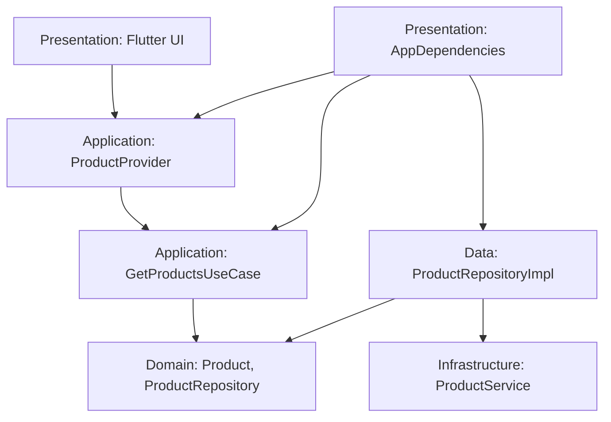

# Інтернет-магазин на Flutter

Навчальний застосунок для перегляду каталогу товарів.

## Схема архітектури Clean Architecture



## Опис шарів

- **Domain:** модель Product та інтерфейс ProductRepository.
- Application: GetProductsUseCase — сценарій отримання списку товарів через інтерфейс ProductRepository; ProductProvider — керування станом застосунку.
- **Data:** ProductRepositoryImpl, реалізація репозиторію.
- **Infrastructure:** ProductService, джерело даних.
- **Presentation:** Flutter UI та AppDependencies для Dependency Injection.

## Інструкція запуску

1. Встановити Flutter SDK.
2. Відкрити проєкт у VS Code.
3. Виконати команди:

```bash
flutter pub get
flutter run -d chrome
```

## Перевірка коду

```bash
flutter analyze
```

## Git

Розробка виконувалася в окремих feature-гілках із Pull Requests у develop та подальшим злиттям у main. Тег версії: v1.0.0.
